# QA Pipeline: User Guide

This guide shows you how to take one user story from `test-input/` through the whole testing life cycle with Claude:
requirement analysis, readiness gate, test cases, execution in a real browser with the **Playwright agent-cli**
(no automation code), bug reports, the Extent report and a run summary. Every diagram below can be read on its own.

> The diagrams use Mermaid. They render on GitHub and in VS Code with a Mermaid preview extension. If you have
> neither, open [`user-guide.html`](user-guide.html) in a browser. It is built from this file with
> `node docs/build_user_guide_html.js` and shows the same text and diagrams.

---

## 1. The pipeline at a glance

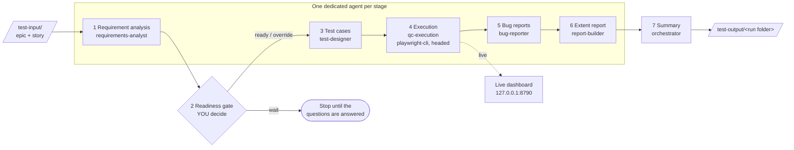

The **orchestrator** coordinates. It never does stage work itself. After each stage it runs a validator
(`pipeline.js complete <stage>`), and the next stage starts only when the validator prints `DONE`.

| # | Stage | Who | What you get |
|---|---|---|---|
| 1 | Requirement analysis | `requirements-analyst` | acceptance criteria, gaps, **questions**, impact list and **impact graph**, email and Jira drafts |
| 2 | Readiness gate | **you** | blocking notice (draft) and gate record |
| 3 | Test cases | `test-designer` | suite JSON + Markdown + CSV: **Target** cases for the story, **Impacted** cases for the modules it can break |
| 4 | Execution | `qc-execution` | every step's actual result and screenshot, `results.json`, execution log |
| 5 | Bug reports | `bug-reporter` | triage of every failure; bug drafts only for confirmed defects |
| 6 | Extent report | `report-builder` | one self-contained `report.html` |
| 7 | Summary | orchestrator | `run-summary.md`, including **what was not posted or sent** |

---

## 2. One-time setup

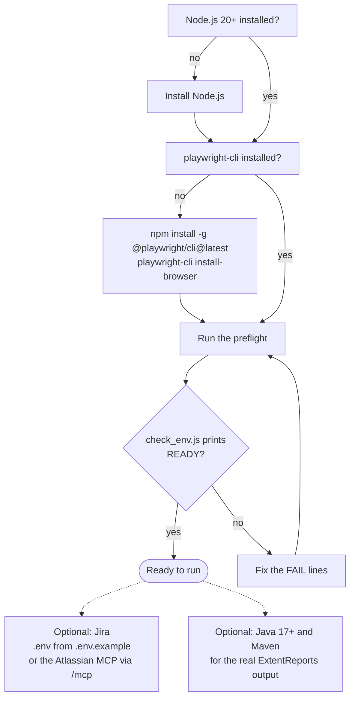

Preflight command:
```bash
node skill/3-TestExecutionSkill/scripts/check_env.js --url https://www.saucedemo.com
```

---

## 3. Run a story (quick start)

1. Put the epic and the story in `test-input/` (see `test-input/README.md` for the format).
2. Start Claude Code with the orchestrator as the main agent:
   ```bash
   claude --agent orchestrator
   ```
3. Ask: **"Run the QA pipeline for story SD-02."**
4. Answer the setup questions: the URL, the scope (the maximum number of test cases), headed or headless, and whether you want the live dashboard.
5. Read the analysis, the questions, the impact graph and the blocking notice. **Then** decide the gate.
6. If you chose headed mode, watch the browser. Watch the dashboard too.
7. Open `report/report.html` and `summary/run-summary.md` in the run folder.

### What happens between you and the agents

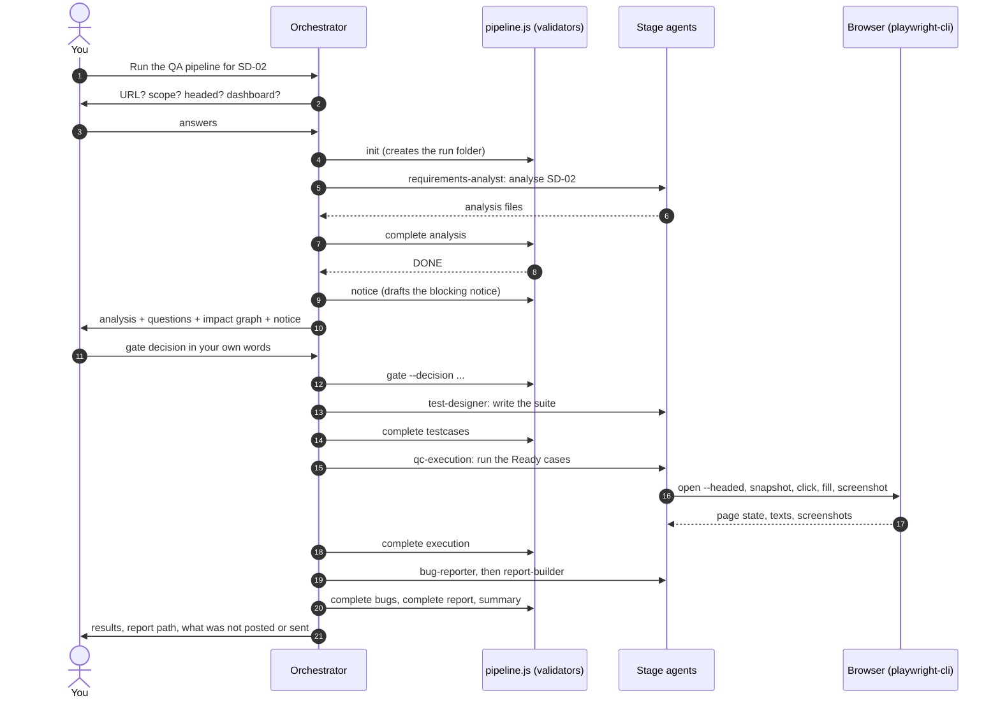

---

## 4. The readiness gate

No test case is written until the gate is decided. The gate is **met** only when all four conditions hold:

1. All requirement questions are answered by a named person.
2. The requirement is clear.
3. Jira is updated with the answers.
4. The stakeholder email is updated.

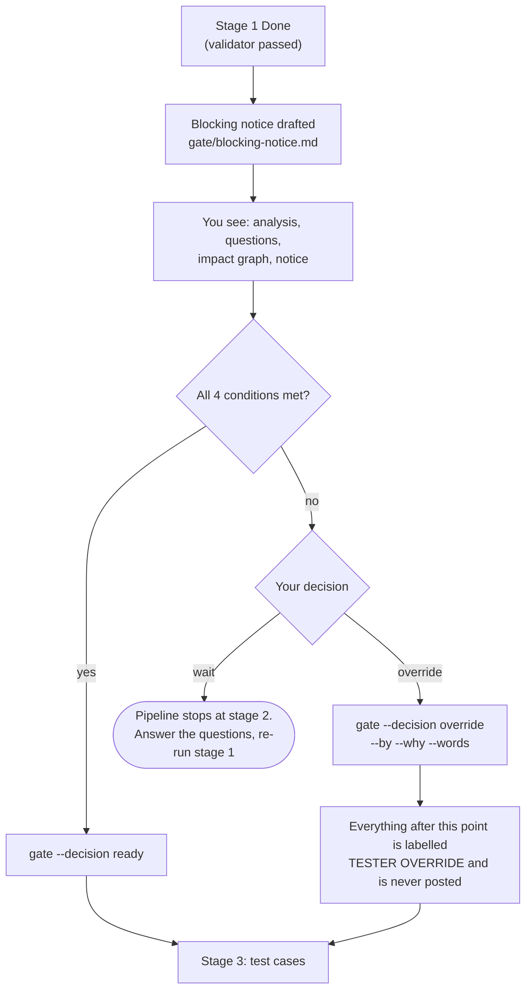

You are only ever asked **after** you have seen the work (make first, then ask). An earlier answer is never reused.

---

## 5. Impacted modules

Stage 1 scores every module the story can affect: **Likelihood (1-3) x Severity (1-3)**.

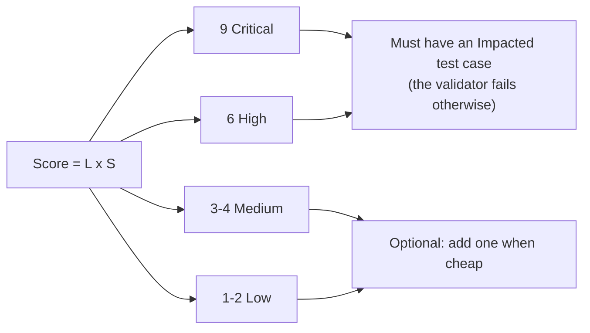

The **impact graph** (`analysis/<EPIC>-<ID>-graph.html`) draws the epic's dependency chain. The target story is green,
and every other story is coloured by its impact level. For SD-02:

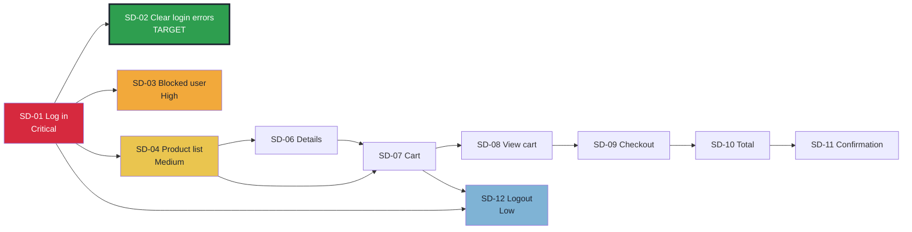

---

## 6. Execution: how a test is performed and recorded

The `qc-execution` agent is the tester at the keyboard. It runs `playwright-cli` commands itself (open, snapshot,
click, fill, press, eval, screenshot) and writes **no test code**. `record_result.js` is its notebook. It records
every step and refuses a dishonest record: a pass without a screenshot, a changed expected result, a Blocked case being run.

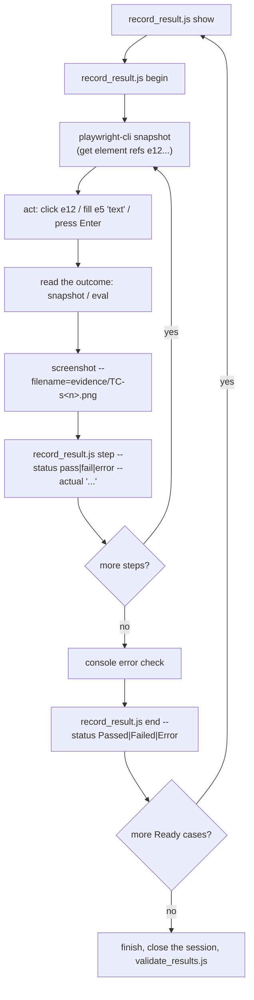

### Test statuses

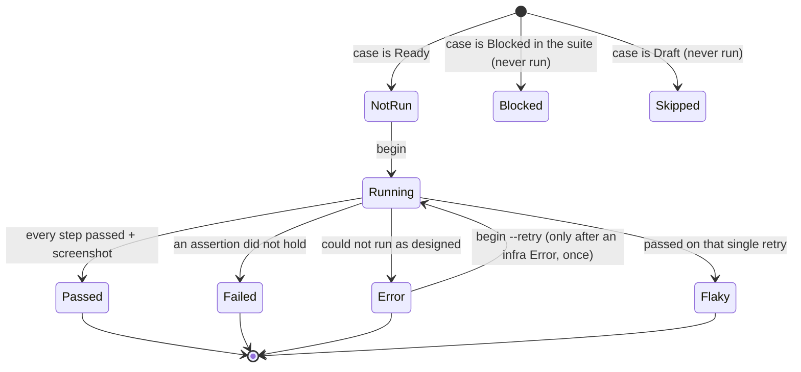

| Status | Means | Example |
|---|---|---|
| **Passed** | Every step ran and every check held | Valid login opens Products |
| **Failed** | It ran as designed and a check did not hold | The message has an extra "Epic sadface: " |
| **Error** | It could not run as designed | The site did not answer, the browser crashed |
| **Flaky** | It passed only on its one retry after an infrastructure error | Never counted as Passed |
| **Blocked** | The case rests on an open question; it was never run | Both fields empty: no expected result |
| **Skipped / Not Run** | Not Ready, or planned but never reached | |

**Failed is never merged into Error**, and expected results are never changed to get green.

---

## 7. Bug triage

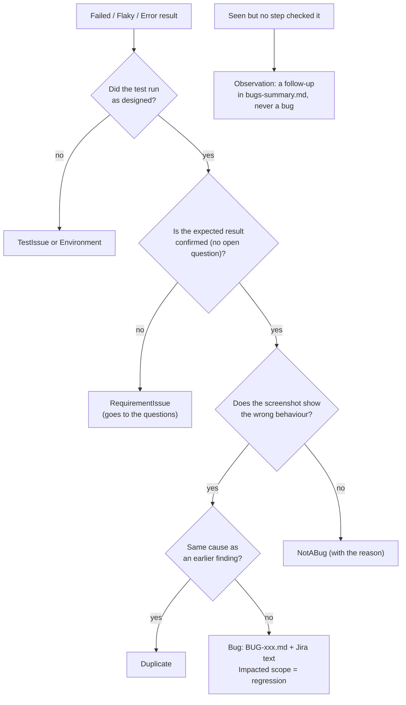

---

## 8. Where everything goes

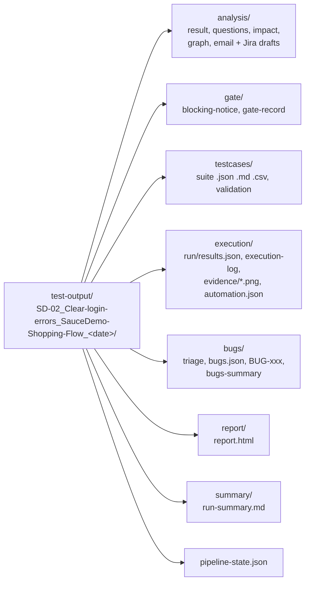

Every new run gets its own folder. A re-run of the same story on the same day gets `-v2`.

---

## 9. Reading the results

- **Live dashboard** (during execution): http://127.0.0.1:8790/. It refreshes every 2 seconds and closes itself 60 seconds after the run.
- **Extent report**: `report/report.html`, one file with the screenshots embedded. It shows:
  - the status donut and pass rate
  - the split between Story (Target) and Impacted modules
  - filters (Issues, each status, Target, Impacted)
  - every case with its steps, expected vs actual results, the playwright-cli commands used, and the screenshots
- **Summary**: `summary/run-summary.md`: stages, gate, results by scope, bugs, notes and cleanup, and **what was not posted or sent**.
- **Board**: `node .claude/skills/qa-orchestrator/scripts/pipeline.js status --run-dir <run folder>`.

### Example: the SD-02 run

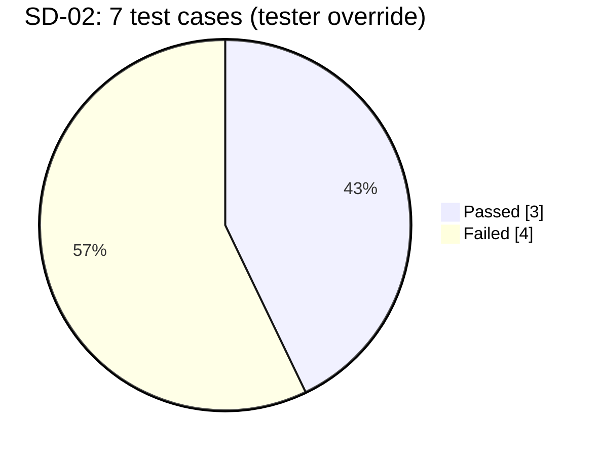

| Scope | Passed | Failed | Note |
|---|---|---|---|
| Story (Target) | 1 | 3 | All 3 failures: the live message adds "Epic sadface: " (open question Q-01) |
| Impacted | 2 | 1 | Valid login still works; locked-out user is still kept out, but the message has the prefix |

Triage filed **0 bugs** and **4 requirement issues**, all tied to Q-01. It also listed one observation for follow-up:
a `session-username` cookie is set after a rejected login.

---

## 10. Jira

There are two ways to reach Jira. Both follow the same rule: **nothing is written without your approval of the exact content**,
and SAMPLE runs and tester-override runs are never posted.

| | `jira.js` (REST) | Atlassian MCP |
|---|---|---|
| Set up | `.env` from `.env.example` (API token) | `.mcp.json` declares `atlassian`; run `/mcp` and authenticate in the browser |
| Write safety | built-in dry run, then `--execute --approved-by` | the orchestrator shows you the payload first, then makes one call |

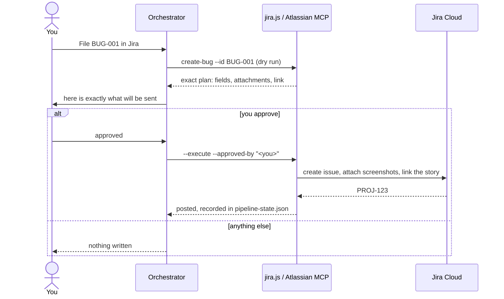

Commands:
```bash
node .claude/skills/qa-orchestrator/scripts/jira.js read --key PROJ-12 --out test-input/PROJ-12-story.md
node .claude/skills/qa-orchestrator/scripts/jira.js create-bug --id BUG-001 --run-dir <run> --link PROJ-12      # dry run
node .claude/skills/qa-orchestrator/scripts/jira.js comment --key PROJ-12 --file <run>/analysis/<ID>-jira-comment.md --run-dir <run>
```

---

## 11. Run one skill on its own

Each stage's scripts work without the orchestrator. The command list is in the main [README](../README.md#run-one-skill-on-its-own)
and in each skill's `README.md`.

---

## 12. Troubleshooting

| Symptom | Cause | Fix |
|---|---|---|
| `check_env.js`: playwright-cli FAIL | Not installed | `npm install -g @playwright/cli@latest`, then `playwright-cli install-browser` |
| `Executable doesn't exist` when opening | Browser binary missing | `playwright-cli install-browser`, then start the run again (this is not a retry) |
| The CLI prints output, then crashes on exit (`UV_HANDLE_CLOSING`) | Known benign Windows/Node issue | The command worked; trust the output |
| `complete <stage>` prints FAILED | A validator found a problem | Read the error lines; the stage agent fixes them (never by changing facts) |
| `gate --decision ready` refused | A condition is not met | Answer the questions, or decide wait / override |
| Dashboard: "port 8790 is in use" | Another run's dashboard | `--port 8791` |
| `.playwright-cli/` folder in the project root | CLI scratch (snapshots, console logs) | Safe to delete after the run |
| Jira write refused | SAMPLE or tester-override run | By design: these runs are never posted |
| The Atlassian MCP tools are missing | The server is not authenticated | `/mcp`, choose `atlassian`, authenticate |

---

## 13. Glossary

| Term | Meaning |
|---|---|
| AC | Acceptance criterion (`AC-1`) |
| Gap / Question | Something the story does not say (`G-01`) / what we ask to close it (`Q-01`) |
| Impact | A module the story can break (`IM-01`), scored L x S |
| Target / Impacted | A test for the story itself / a regression test for an impacted module |
| Tester override | Proceeding although the gate is not met; your decision, recorded and labelled |
| Observation-derived | An expected result taken from what the site showed; a pass means "behaves as observed" |
| SAMPLE | A demo run to exercise the skills; labelled and never posted |
| Session | The named browser playwright-cli uses for one run (`-s=qa-sd-02-...`) |
